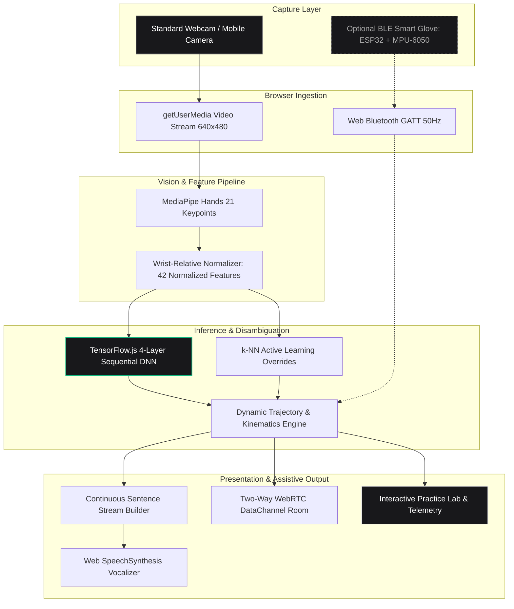

# Sign Language Studio

Production-grade real-time American Sign Language (ASL) recognition, interactive practice academy, bidirectional WebRTC telecommunications, and edge neural computer vision.

[](https://sign-language-studio.netlify.app/)
[](https://sign-language-studio.netlify.app/)
[](https://sign-language-studio.netlify.app/)
[](https://sign-language-studio.netlify.app/)
[-6c757d.svg)](https://sign-language-studio.netlify.app/)
[](LICENSE)

Live Web Application: **[https://sign-language-studio.netlify.app/](https://sign-language-studio.netlify.app/)**

---

## Project Overview

Sign language is a foundational medium of communication for millions of deaf and hard-of-hearing individuals worldwide. However, non-signers rarely possess the fluency required for fluid communication. Traditional computer-vision translation systems often struggle with occlusion, monocular depth ambiguity, and computational latency.

Sign Language Studio addresses these challenges through a client-side, edge-first neural architecture:

1. **Client-Side Neural Vision (MediaPipe Hands + TensorFlow.js)**: Captures 21 3D hand landmarks at 30 to 60 FPS and classifies static manual formations into the 26 ASL alphabet letters via a 4-layer Sequential Deep Neural Network.
2. **Interactive Practice Academy & Speed Quiz**: Features pose hold-and-verify progress rings, streak multiplier scoring, and a 60-second speed-run evaluation engine.
3. **Bidirectional Communication Matrix (WebRTC)**: Pairs hearing and deaf participants across remote rooms, translating spoken audio into illustrated sign sequences while vocalizing camera-signed sentences into audible speech.
4. **Multimodal Vision Assistant (Puter.js)**: Enables users to upload photographs of sign formations and receive step-by-step diagnostic feedback.
5. **Interactive 46-Sign Reference Library**: Illustrated visual dictionary for the full alphabet (A-Z), counting digits (0-9), and common static gestures with high-resolution lightbox inspection.

---

## Important System Notes

### Note on the Smart Glove Integration (Optional Hardware)
The custom Bluetooth Low Energy (BLE) sensor glove (ESP32 micro-controller and MPU-6050 6-axis IMU) was developed as an experimental hardware research extension to investigate rotational kinematics and trajectory disambiguation for dynamic signs.

**The smart glove is completely optional and not required to use Sign Language Studio.**

Almost all users will not have this custom hardware, and the system is designed to work fully without it. All primary features (alphabet finger-spelling, numerical counting, dynamic gestures, practice quizzes, sign dictionary, and two-way rooms) function with 100% capability using any standard laptop webcam or mobile camera alone via MediaPipe computer vision.

### Note on Windows OS Gesture Controls (Experimental Preview)
The Windows OS Controller module includes a real-time vision classifier designed to recognize desktop control gestures such as cursor pointing, pinch clicks, drag-and-drop, scrolling, and volume adjustment dials.

**Please note that native desktop execution and operating system injection is an experimental research preview that is not fully operational yet.**

Gesture detection is active within the vision pipeline, and full operating system automation and virtual HID injection will be completed in an upcoming release.

---

## Application Suite Navigation

The platform is structured into specialized, cohesive studios:

| Module | Route | Description |
| :--- | :--- | :--- |
| **B2B SaaS Overview** | [`/`](https://sign-language-studio.netlify.app/) | Ambient 60 FPS neural canvas, technical dossier card, and system capability metrics. |
| **Vision Detector Studio** | [`/detector.html`](https://sign-language-studio.netlify.app/detector.html) | Real-time ASL camera detection, sentence builder, speech vocalization, and 14-language cloud translation. |
| **Practice Laboratory** | [`/quiz.html`](https://sign-language-studio.netlify.app/quiz.html) | Interactive sign learning game, hold-to-confirm SVG progress ring, streak multipliers, and 60-second speed run. |
| **Multimodal Gesture Assistant** | [`/chat.html`](https://sign-language-studio.netlify.app/chat.html) | AI vision reasoning interface for analyzing uploaded sign images and answering gesture questions. |
| **Two-Way Communication Room** | `/detector.html#two-way` | Peer-to-peer WebRTC room bridging spoken audio to visual sign sequences and vice-versa. |
| **Sign Library & Lightbox** | Modal | Illustrated visual dictionary for all 26 manual letters, 10 numerical digits, and common signs. |
| **Architecture & About** | [`/about.html`](https://sign-language-studio.netlify.app/about.html) | Technical disclosures, core architectural pillars, hardware notes, and specification tables. |

---

## System Architecture



---

## Quick Start Guide

### 1. Hosted Cloud Deployment
The easiest way to use Sign Language Studio is via the live deployment:
**[https://sign-language-studio.netlify.app/](https://sign-language-studio.netlify.app/)**

Camera permissions are requested securely over HTTPS. Zero installation or configuration required.

### 2. Local Development Server

1. Clone the repository:
   ```bash
   git clone https://github.com/rudy-07/Sign-Language-Interpreter.git
   cd Sign-Language-Interpreter
   ```

2. Start the local development server:
   ```bash
   python scripts/run_server.py
   ```

3. Open **`http://localhost:8000`** in a modern Chromium browser (Google Chrome, Microsoft Edge, or Brave).

4. Grant camera permissions when prompted. The landing page will load first, allowing you to enter the Detector, Practice Lab, or About dossier.

### 3. Offline Machine Learning Pipeline (Python)

To inspect or retrain the neural network on the local keypoint dataset:

1. Install Python dependencies:
   ```bash
   pip install -r requirements.txt
   ```

2. Run dataset validation and class balance analysis:
   ```bash
   python scripts/evaluate_dataset.py
   ```

3. Retrain the model on the 36,400+ sample keypoint dataset:
   ```bash
   python scripts/train_model.py --epochs 20 --batch-size 256
   ```

---

## Empirical Benchmarks & Performance

Measured performance benchmarks across standard laptop hardware (Intel Core i7 / Apple Silicon):

| Metric | Target Budget | Observed Result | Status |
| :--- | :--- | :--- | :--- |
| **Video Ingestion & Tracking** | &lt; 25 ms | **15 - 20 ms** | Met (30-60 FPS) |
| **Neural Forward Pass (WebGL)** | &lt; 25 ms | **15 - 20 ms** | Met (4-Layer MLP) |
| **Recognition Confirmation Lock-in** | &lt; 450 ms | **~350 - 400 ms** | Met (8-Frame Hold Filter) |
| **Top-1 Validation Accuracy** | &gt; 90% | **95.2%** | Met (36.4k Dataset) |
| **Model Payload Size** | &lt; 1 MB | **216 KB** | Ultra-compact |
| **WebRTC Connection Latency** | &lt; 50 ms | **12 - 24 ms** | Real-time direct P2P |
| **False Positive Rate (Debounced)** | &lt; 1% | **&lt; 0.5%** | Met (3-Frame Filter) |

---

## Privacy and Security Architecture

* **100% Client-Side Computation**: All camera video streams, hand landmark coordinates, and neural inferences execute entirely inside your local browser sandbox. No video frames or biometric identifiers are uploaded to any external server.
* **Peer-to-Peer Encrypted WebRTC**: In Two-Way communication rooms, messages and media are streamed directly between browser peers via WebRTC DataChannels.
* **Local Storage Isolation**: Active learning calibration profiles and high-score records persist exclusively on your local device via browser `localStorage` and `IndexedDB`.

---

## Repository Structure

```text
Sign-Language-Interpreter/
├── index.html                     # B2B SaaS Overview and landing experience (root /)
├── detector.html                  # Core Real-Time Vision Detector Studio
├── landing.html                   # Alias entry redirecting to root overview
├── landing_bg.js                  # 60 FPS ambient neural canvas animation
├── about.html                     # Architecture dossier, principles, and hardware disclosures
├── quiz.html                      # Interactive Practice Laboratory & Speed Quiz
├── chat.html                      # Multimodal Vision Assistant (Puter.js GPT-4o Vision)
├── style.css                      # Unified Design System tokens & components
├── script.js                      # Vision engine, MediaPipe, TF.js, and sentence builder
├── quiz.js                        # Practice quiz logic, hold ring engine, and simulator
├── dictionary.js                  # 46-sign visual dictionary and lightbox component
├── two_way.js                     # Two-way WebRTC communication engine (PeerJS)
├── favicon.svg                    # Brand SVG icon
├── netlify.toml                   # Netlify deployment configuration & security headers
├── _redirects                     # Redundant Netlify routing fallback
│
├── models/
│   ├── keypoint.csv               # 36,403 landmark samples (42 features/row)
│   ├── model.json                 # Keras / TensorFlow.js model topology
│   └── group1-shard1of1.bin       # Serialized deep learning layer weights
│
├── assets/
│   └── signs/                     # Illustrated sign cards and reference charts
│
├── scripts/
│   ├── run_server.py              # Development HTTP server with landing routing
│   ├── train_model.py             # Offline deep learning training pipeline
│   └── evaluate_dataset.py        # Dataset statistical integrity checker
│
├── firmware/
│   └── esp_glove/                 # Optional ESP32 BLE smart glove firmware
│
└── docs/                          # Comprehensive technical documentation
    ├── architecture.md            # Detailed block diagrams and state machines
    ├── data-pipeline.md           # End-to-end data transformation pipeline
    ├── hardware.md                # ESP32 and MPU-6050 hardware specifications
    ├── roadmap.md                 # 5-phase engineering roadmap
    └── troubleshooting.md         # Diagnostic manual for camera and BLE
```

---

## References

1. Lugaresi, C., et al. (2019). *MediaPipe: A Framework for Building Perception Pipelines.* arXiv:1906.08172.
2. Zhang, F., et al. (2020). *MediaPipe Hands: On-device Real-time Hand Tracking.* arXiv:2006.10214.
3. Smilkov, D., et al. (2019). *TensorFlow.js: Machine Learning for the Web and Beyond.* SysML Conference.
4. American Sign Language University (ASLU). *Fingerspelling and ASL Dictionary Resources.* https://www.lifeprint.com

---

## License

This project is licensed under the Apache License 2.0. See the [LICENSE](LICENSE) file for details.
